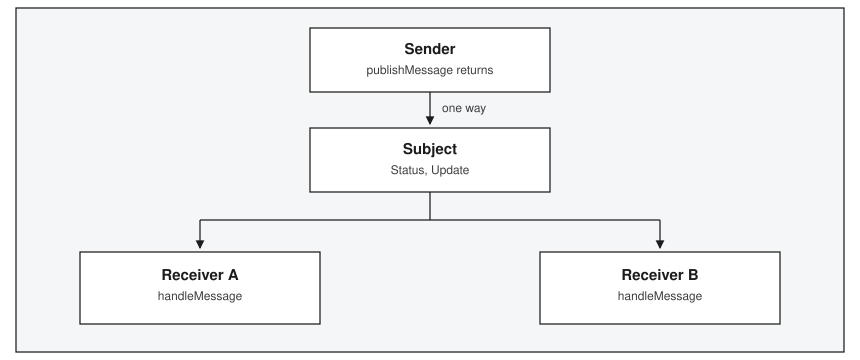
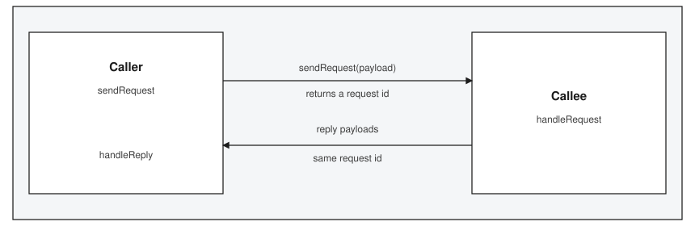

Connection
==========

Package ``at.ac.ait.lablink.core.connection`` sends payloads between clients.
``ILlConnection`` is the interface the datapoint service, the sync host, and any other caller use.
One connection offers two patterns: a message, and a remote procedure call.
Both patterns share the publishing unit in ``at.ac.ait.lablink.core.connection.publishing``.

Messages
--------

Package ``at.ac.ait.lablink.core.connection.messaging`` is publish and subscribe.
``publishMessage(MsgSubject, IPayload)`` sends one payload on a subject.
The sender does not wait for a receiver.
A subject is a list of elements, for example a datapoint update for a named value.
``MsgSubscription`` describes the subjects a client listens to.
``IMessageCallback`` is invoked when a matching message arrives.

   A message is published once and delivered to every matching receiver.

The sender builds a subject and publishes one payload.
The call returns as soon as the connection has accepted the message.
A receiver subscribes to the same subject and reads the payloads in ``handleMessage``.
``handleError`` is the other method of ``IMessageCallback``.

.. code-block:: java

   MsgSubject subject = MsgSubject.getBuilder()
       .addSubjectElement("Status")
       .addSubjectElement("Update")
       .build();

   connection.publishMessage(subject, payload);

   MsgSubscription subscription = MsgSubscription
       .getBuilder(MsgSubscription.EMsgSourceChooser.RECEIVE_FROM_ALL)
       .addSubjectElement("Status")
       .addSubjectElement("Update")
       .build();

   connection.registerMessageHandler(subscription, new IMessageCallback() {
     @Override
     public void handleMessage(MsgHeader header, List<IPayload> payloads) {
       // payloads are the published value
     }

     @Override
     public void handleError(Header header, List<ErrorMessage> errors) {
     }
   });

Remote calls
------------

Package ``at.ac.ait.lablink.core.connection.rpc`` is request and reply.
``IRpcRequester.sendRequest`` sends a payload to an ``RpcDestination`` and returns the identifier of that request.
The destination names who should answer.
A second form of ``sendRequest`` sets how many replies to wait for.
A count of ``-1`` keeps the channel open until the timeout, so an unknown number of replies can arrive.
``RpcSubject`` names the call.
The reply travels back to the requester that sent the matching request.

   A remote call sends a payload and later receives the reply for that request.

The callee registers ``handleRequest`` for a subject.
The method returns the payloads that go back to the caller.
The caller registers ``handleReply`` for the same subject and receives an ``IRpcRequester``.
``sendRequest`` addresses one client and returns the request identifier.
The matching reply arrives later in ``handleReply``.

.. code-block:: java

   RpcSubject subject = RpcSubject.getBuilder()
       .addSubjectElement("ReadStatus")
       .build();

   connection.registerRequestHandler(subject, new IRpcRequestCallback() {
     @Override
     public List<IPayload> handleRequest(RpcHeader header, List<IPayload> payloads) {
       return Collections.singletonList(reply);
     }

     @Override
     public void handleError(Header header, List<ErrorMessage> errors) {
     }
   });

   IRpcRequester requester = connection.registerReplyHandler(subject,
       new IRpcReplyCallback() {
         @Override
         public void handleReply(RpcHeader header, List<IPayload> payloads) {
           // payloads belong to the request identifier
         }

         @Override
         public void handleError(Header header, List<ErrorMessage> errors) {
         }
       });

   RpcDestination destination = RpcDestination
       .getBuilder(RpcDestination.ERpcDestinationChooser.SEND_TO_CLIENT)
       .setGroupId(groupId)
       .setClientId(clientId)
       .build();

   String requestId = requester.sendRequest(destination, payload);

Topics
------

Package ``at.ac.ait.lablink.core.connection.topic`` holds the beans that name a message or a call on the transport: ``MsgSubject``, ``MsgSubscription``, ``RpcSubject``, and ``RpcDestination``.

Transport
---------

Package ``at.ac.ait.lablink.core.connection.mqtt`` is the low-level transport used by the core.
The MQTT client is best-effort and synchronous.
The interfaces between this package and the layers above it are the place where another MQTT client, including an asynchronous one, can be substituted.

Payloads are JSON.
``JsonEncoder`` writes an encodable object to a JSON string.
``JsonDecoder`` reads that string back.
A class that crosses the connection is registered with ``registerEncodableFactory`` on ``ILlConnection`` before it is sent.
``shutdown`` closes the connection.

Yellow pages
------------

The MQTT host publishes a JSON description of the client's datapoints.
``LlClient.getYellowPageJson`` returns that document.
``MqttCommInterfaceUtility.getYellowPagePojo`` parses it into ``MqttYellowPageForClient``.
The description itself is a string datapoint named ``ClientYellowPage``, with identifier ``ClientYellowPagesJson``.
