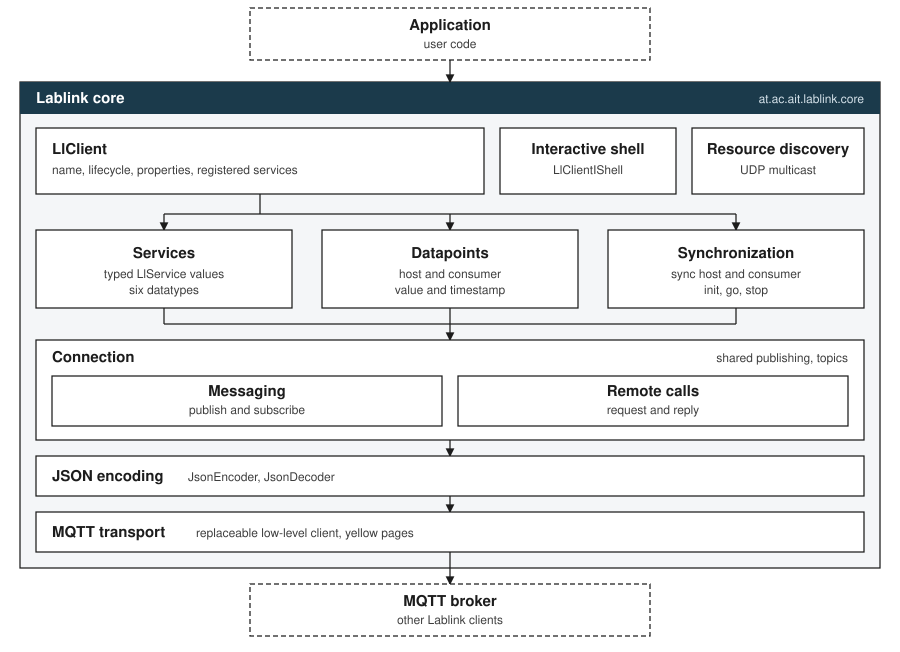

**********************************************
AIT Lablink Core library (Java implementation)
**********************************************

.. meta::
   :description lang=en: AIT Lablink core library (Java implementation)

This library is the Java implementation of the AIT Lablink core.
It is published as the Maven artifact ``at.ac.ait.lablink:core``.
A client joins a scenario, hosts values, and exchanges them with other clients over MQTT.

Applications use :doc:`client` and typed :doc:`services`.
:doc:`datapoints` and :doc:`synchronization` sit on the same :doc:`connection`.
Clients advertise themselves through :doc:`resource discovery <resource-discovery>`, and a running client can open an :doc:`interactive shell <shell>`.

   Architecture of the Java core library.
   Solid arrows are the value path.
   The shell and resource discovery stay with the client.
   Resource discovery uses UDP multicast.

Client
======

A client is the process that joins a Lablink scenario and hosts services.
Find the client lifecycle :doc:`here <client>`.

.. toctree::
   :maxdepth: 2
   :hidden:
   :caption: Client

   /client

Services
========

Services are the values a client publishes and accepts.
Find the service types :doc:`here <services>`.

.. toctree::
   :maxdepth: 2
   :hidden:
   :caption: Services

   /services

Datapoints
==========

Datapoints carry a typed value and a timestamp between a host and its consumers.
Find the datapoint service :doc:`here <datapoints>`.

.. toctree::
   :maxdepth: 2
   :hidden:
   :caption: Datapoints

   /datapoints

Synchronization
===============

A sync host steps every registered client through a simulation or an emulation.
Find the synchronization service :doc:`here <synchronization>`.

.. toctree::
   :maxdepth: 2
   :hidden:
   :caption: Synchronization

   /synchronization

Connection
==========

Messages and remote calls travel on one connection, encoded as JSON and sent over MQTT.
Find the connection layer :doc:`here <connection>`.

.. toctree::
   :maxdepth: 2
   :hidden:
   :caption: Connection

   /connection

Resource discovery
==================

Clients advertise their metadata on a multicast group so other clients can find them.
Find resource discovery :doc:`here <resource-discovery>`.

.. toctree::
   :maxdepth: 2
   :hidden:
   :caption: Resource discovery

   /resource-discovery

Interactive shell
=================

A client can open a console for reading and writing its services.
Find the shell commands :doc:`here <shell>`.

.. toctree::
   :maxdepth: 2
   :hidden:
   :caption: Interactive shell

   /shell
