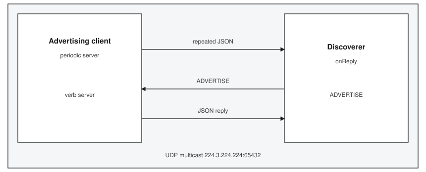

Resource discovery
==================

Package ``at.ac.ait.lablink.core.rd`` lets a client announce itself, and lets another client collect those announcements.
The announcement is a JSON document (``ResourceDiscoveryClientMeta``) sent as a UDP multicast datagram.
``LlClient.getResourceDiscoveryMeta`` builds the document for the running client.

``Configuration`` fixes the address every discovery participant uses.

.. topic:: Discovery constants

  :Group: ``224.3.224.224`` (``RESOURCE_DISCOVERY_GROUP_IPV4``)
  :Port: ``65432`` (``RESOURCE_DISCOVERY_GROUP_PORT``)
  :Time to live: ``10`` (``RESOURCE_DISCOVERY_TTL_SCOPE``)
  :Encoding: JSON (``RESOURCE_DISCOVERY_ENCODING_USE``)

The time to live is the number of multicast router hops a datagram may cross before it is discarded.

Two servers
-----------

``ResourceDiscoveryPeriodicServer`` repeats the client's JSON advertisement on its own.
The pause between advertisements is ``RESOURCE_DISCOVERY_PERIODIC_ADVERTISE_PAUSE_MS``.
After ``start``, the client runs this server, so neighbours can learn about it without asking.

``ResourceDiscoveryVerbServer`` answers on the same group when it is asked.
The request verb is ``ADVERTISE`` (``RESOURCE_DISCOVERY_ADVERTISE_VERB``).
The server replies with the same JSON advertisement.
``END`` (``RESOURCE_DISCOVERY_END_VERB``) tells the server to stop advertising.

Discovering clients
-------------------

``ResourceDiscovererPeriodic`` listens for the repeated advertisements.
``ResourceDiscovererWithVerb`` sends ``ADVERTISE`` and collects the replies.
The periodic discoverer waits ``RESOURCE_DISCOVERY_SOCKET_TIMEOUT_MS`` for a single reply.
A discovery session lasts ``RESOURCE_DISCOVERY_ADVERTISE_WAIT_MS``.
Incoming JSON is placed in a buffer of ``RESOURCE_DISCOVERY_BUFFER_SIZE`` bytes.

``IResourceDiscoveryNotifier.onReply`` runs when an advertisement arrives.
The argument is a ``ResourceMessage``.
``RdUtility`` selects the local network interface used for the multicast socket.

Example
-------

   Advertisements travel on one UDP multicast group.
   A periodic advertisement needs no request.
   ``ADVERTISE`` asks the verb server for the same JSON.

A started ``LlClient`` already runs ``ResourceDiscoveryPeriodicServer``.
The sketch below constructs that server from the client's metadata, then listens, and then asks.

.. code-block:: java

   ResourceDiscoveryClientMeta meta = client.getResourceDiscoveryMeta();

   ResourceDiscoveryPeriodicServer server =
       new ResourceDiscoveryPeriodicServer(meta);
   server.start();

   IResourceDiscoveryNotifier notifier = new IResourceDiscoveryNotifier() {
     @Override
     public void onReply(ResourceMessage message) {
       String advertisement = message.getPayload();
     }
   };

   ResourceDiscovererPeriodic listener = new ResourceDiscovererPeriodic(notifier);
   listener.start();

   ResourceDiscovererWithVerb asker = new ResourceDiscovererWithVerb(notifier);
   asker.start();

``getPayload`` is the JSON advertisement.
``ResourceDiscovererWithVerb`` sends ``ADVERTISE`` once and passes each reply to the same notifier.
